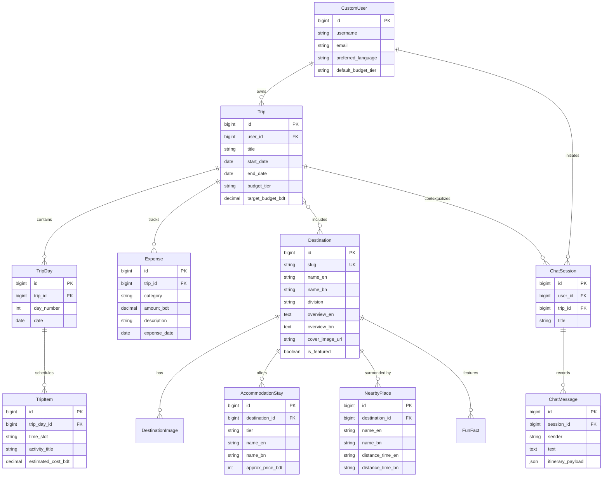

# Backend Data Models Documentation

This document provides a comprehensive, app-by-app reference for all Django database models in the Bangladesh Travel Planner backend.

---

## Architecture & Conventions

1. **Primary Keys**: BigAutoField (standard 64-bit integer IDs).
2. **Bilingual Content**: Dual-field convention (`field_en` and `field_bn`) for destination data, allowing direct SQL queries, straightforward serialization, and full bilingual fidelity without complex JSON querying.
3. **Currency & Precision**: All financial amounts are stored in Bangladeshi Taka (BDT) using `DecimalField(max_digits=10, decimal_places=2)`.
4. **Referential Integrity**: Cascade deletes (`on_delete=models.CASCADE`) are used where child entities logically depend on the parent (e.g. deleting a Trip removes its TripDays and Expenses).

---

## Table of Contents
1. [App: accounts](#1-app-accounts)
2. [App: destinations](#2-app-destinations)
3. [App: trips](#3-app-trips)
4. [App: budgets](#4-app-budgets)
5. [App: ai_assistant](#5-app-ai_assistant)

---

## 1. App: `accounts`

### Overview
Manages custom user authentication, profile data, language preference, and travel defaults.

### Model: `CustomUser`
Inherits from `django.contrib.auth.models.AbstractUser`.

#### Fields

| Field Name | Type | Attributes / Constraints | Description |
|---|---|---|---|
| `id` | `BigAutoField` | `primary_key=True` | Unique identifier |
| `username` | `CharField` | `max_length=150`, `unique=True` | User login handle |
| `email` | `EmailField` | `unique=True`, `db_index=True` | User email address |
| `preferred_language` | `CharField` | `max_length=5`, `choices=[('en', 'English'), ('bn', 'বাংলা')]`, `default='en'` | Persisted language selection |
| `default_budget_tier` | `CharField` | `max_length=20`, `choices=[('budget', 'Budget'), ('mid_range', 'Mid-Range'), ('luxury', 'Luxury')]`, `default='mid_range'` | Default preference for solo travel stays |
| `created_at` | `DateTimeField` | `auto_now_add=True` | Registration timestamp |
| `updated_at` | `DateTimeField` | `auto_now=True` | Profile update timestamp |

#### Code Representation (`backend/apps/accounts/models.py`)

```python
from django.contrib.auth.models import AbstractUser
from django.db import models


class CustomUser(AbstractUser):
    LANGUAGE_CHOICES = (
        ("en", "English"),
        ("bn", "বাংলা"),
    )

    BUDGET_TIER_CHOICES = (
        ("budget", "Budget (বাজেট)"),
        ("mid_range", "Mid-Range (মাঝারি)"),
        ("luxury", "Luxury (বিলাসবহুল)"),
    )

    email = models.EmailField(unique=True, db_index=True)
    preferred_language = models.CharField(
        max_length=5,
        choices=LANGUAGE_CHOICES,
        default="en",
        help_text="User's preferred UI and content language",
    )
    default_budget_tier = models.CharField(
        max_length=20,
        choices=BUDGET_TIER_CHOICES,
        default="mid_range",
        help_text="Default budget tier for recommendations",
    )
    created_at = models.DateTimeField(auto_now_add=True)
    updated_at = models.DateTimeField(auto_now=True)

    class Meta:
        verbose_name = "User"
        verbose_name_plural = "Users"
        ordering = ["-date_joined"]

    def __str__(self):
        return f"{self.username} ({self.get_preferred_language_display()})"
```

---

## 2. App: `destinations`

### Overview
Stores hard-coded Bangladesh travel destinations, curated solo-traveler accommodation stays categorized by budget tier, nearby exploration spots, trivia facts, and image galleries.

### Models Summary
1. `Destination`: Core destination entity with division, slug, and bilingual overview.
2. `DestinationImage`: Gallery images for the destination detail page.
3. `AccommodationStay`: Stays categorized by budget tier (`budget`, `mid_range`, `luxury`) with solo traveler BDT pricing.
4. `NearbyPlace`: Spots to explore with travel time and distance estimates from the destination center.
5. `FunFact`: Engaging trivia in English and Bengali.

---

### Model: `Destination`

#### Fields

| Field Name | Type | Attributes / Constraints | Description |
|---|---|---|---|
| `id` | `BigAutoField` | `primary_key=True` | Unique identifier |
| `slug` | `SlugField` | `max_length=100`, `unique=True`, `db_index=True` | URL slug (e.g. `sreemangal`, `sajek-valley`) |
| `name_en` | `CharField` | `max_length=150` | English name (e.g. "Sreemangal") |
| `name_bn` | `CharField` | `max_length=150` | Bengali name (e.g. "শ্রীমঙ্গল") |
| `division` | `CharField` | `max_length=50`, `choices=DIVISION_CHOICES` | Division of Bangladesh |
| `overview_en` | `TextField` | | English overview paragraph |
| `overview_bn` | `TextField` | | Bengali overview paragraph |
| `best_time_to_visit_en` | `CharField` | `max_length=150` | e.g. "October to March" |
| `best_time_to_visit_bn` | `CharField` | `max_length=150` | e.g. "অক্টোবর থেকে মার্চ" |
| `cover_image_url` | `URLField` | `max_length=500` | High-res cover image URL |
| `is_featured` | `BooleanField` | `default=False`, `db_index=True` | Display on Home page hero/highlights |
| `created_at` | `DateTimeField` | `auto_now_add=True` | Seed/creation timestamp |

---

### Model: `DestinationImage`

#### Fields

| Field Name | Type | Attributes / Constraints | Description |
|---|---|---|---|
| `id` | `BigAutoField` | `primary_key=True` | Unique identifier |
| `destination` | `ForeignKey` | `to=Destination`, `on_delete=CASCADE`, `related_name='images'` | Parent destination |
| `image_url` | `URLField` | `max_length=500` | Photo image URL |
| `caption_en` | `CharField` | `max_length=255`, `blank=True` | English image caption |
| `caption_bn` | `CharField` | `max_length=255`, `blank=True` | Bengali image caption |
| `order_index` | `PositiveSmallIntegerField` | `default=0` | Display ordering |

---

### Model: `AccommodationStay`

#### Fields

| Field Name | Type | Attributes / Constraints | Description |
|---|---|---|---|
| `id` | `BigAutoField` | `primary_key=True` | Unique identifier |
| `destination` | `ForeignKey` | `to=Destination`, `on_delete=CASCADE`, `related_name='stays'` | Associated destination |
| `tier` | `CharField` | `max_length=20`, `choices=[('budget', 'Budget'), ('mid_range', 'Mid-Range'), ('luxury', 'Luxury')]`, `db_index=True` | Budget classification |
| `name_en` | `CharField` | `max_length=200` | Hotel / eco-resort English name |
| `name_bn` | `CharField` | `max_length=200` | Hotel / eco-resort Bengali name |
| `approx_price_bdt` | `PositiveIntegerField` | | Estimated solo per-night rate in BDT |
| `price_range_label_en` | `CharField` | `max_length=100` | e.g. "৳800 - ৳1,200 / night" |
| `price_range_label_bn` | `CharField` | `max_length=100` | e.g. "৳৮০০ - ৳১,২০০ / রাত" |
| `features_en` | `TextField` | | Solo perks (e.g. "Solo dorm bed, secure locker, WiFi") |
| `features_bn` | `TextField` | | Solo perks in Bengali |
| `order_index` | `PositiveSmallIntegerField` | `default=0` | Display order |

---

### Model: `NearbyPlace`

#### Fields

| Field Name | Type | Attributes / Constraints | Description |
|---|---|---|---|
| `id` | `BigAutoField` | `primary_key=True` | Unique identifier |
| `destination` | `ForeignKey` | `to=Destination`, `on_delete=CASCADE`, `related_name='nearby_places'` | Associated destination |
| `name_en` | `CharField` | `max_length=200` | English spot name (e.g. "Lawachara National Park") |
| `name_bn` | `CharField` | `max_length=200` | Bengali spot name (e.g. "লাউয়াছড়া জাতীয় উদ্যান") |
| `distance_time_en` | `CharField` | `max_length=150` | e.g. "8 km (25 mins by CNG auto-rickshaw)" |
| `distance_time_bn` | `CharField` | `max_length=150` | e.g. "৮ কিমি (সিএনজি দিয়ে ২৫ মিনিট)" |
| `description_en` | `TextField` | | English description |
| `description_bn` | `TextField` | | Bengali description |
| `order_index` | `PositiveSmallIntegerField` | `default=0` | Display order |

---

### Model: `FunFact`

#### Fields

| Field Name | Type | Attributes / Constraints | Description |
|---|---|---|---|
| `id` | `BigAutoField` | `primary_key=True` | Unique identifier |
| `destination` | `ForeignKey` | `to=Destination`, `on_delete=CASCADE`, `related_name='fun_facts'` | Associated destination |
| `fact_en` | `TextField` | | Engaging trivia in English |
| `fact_bn` | `TextField` | | Engaging trivia in Bengali |
| `order_index` | `PositiveSmallIntegerField` | `default=0` | Display order |

---

#### Code Representation (`backend/apps/destinations/models.py`)

```python
from django.db import models


class Destination(models.Model):
    DIVISION_CHOICES = (
        ("Barishal", "Barishal (বরিশাল)"),
        ("Chattogram", "Chattogram (চট্টগ্রাম)"),
        ("Dhaka", "Dhaka (ঢাকা)"),
        ("Khulna", "Khulna (খুলনা)"),
        ("Mymensingh", "Mymensingh (ময়মনসিংহ)"),
        ("Rajshahi", "Rajshahi (রাজশাহী)"),
        ("Rangpur", "Rangpur (রংপুর)"),
        ("Sylhet", "Sylhet (সিলেট)"),
    )

    slug = models.SlugField(max_length=100, unique=True, db_index=True)
    name_en = models.CharField(max_length=150)
    name_bn = models.CharField(max_length=150)
    division = models.CharField(max_length=50, choices=DIVISION_CHOICES)
    overview_en = models.TextField()
    overview_bn = models.TextField()
    best_time_to_visit_en = models.CharField(max_length=150)
    best_time_to_visit_bn = models.CharField(max_length=150)
    cover_image_url = models.URLField(max_length=500)
    is_featured = models.BooleanField(default=False, db_index=True)
    created_at = models.DateTimeField(auto_now_add=True)

    class Meta:
        ordering = ["name_en"]
        verbose_name = "Destination"
        verbose_name_plural = "Destinations"

    def __str__(self):
        return f"{self.name_en} ({self.name_bn})"


class DestinationImage(models.Model):
    destination = models.ForeignKey(
        Destination, on_delete=models.CASCADE, related_name="images"
    )
    image_url = models.URLField(max_length=500)
    caption_en = models.CharField(max_length=255, blank=True)
    caption_bn = models.CharField(max_length=255, blank=True)
    order_index = models.PositiveSmallIntegerField(default=0)

    class Meta:
        ordering = ["order_index", "id"]


class AccommodationStay(models.Model):
    TIER_CHOICES = (
        ("budget", "Budget (বাজেট)"),
        ("mid_range", "Mid-Range (মাঝারি)"),
        ("luxury", "Luxury (বিলাসবহুল)"),
    )

    destination = models.ForeignKey(
        Destination, on_delete=models.CASCADE, related_name="stays"
    )
    tier = models.CharField(max_length=20, choices=TIER_CHOICES, db_index=True)
    name_en = models.CharField(max_length=200)
    name_bn = models.CharField(max_length=200)
    approx_price_bdt = models.PositiveIntegerField(
        help_text="Approximate solo traveler per-night rate in BDT"
    )
    price_range_label_en = models.CharField(
        max_length=100, help_text="e.g. ৳800 - ৳1,200 / night"
    )
    price_range_label_bn = models.CharField(
        max_length=100, help_text="e.g. ৳৮০০ - ৳১,২০০ / রাত"
    )
    features_en = models.TextField(help_text="Amenities for solo traveler")
    features_bn = models.TextField(help_text="Bengali amenities")
    order_index = models.PositiveSmallIntegerField(default=0)

    class Meta:
        ordering = ["tier", "approx_price_bdt", "order_index"]


class NearbyPlace(models.Model):
    destination = models.ForeignKey(
        Destination, on_delete=models.CASCADE, related_name="nearby_places"
    )
    name_en = models.CharField(max_length=200)
    name_bn = models.CharField(max_length=200)
    distance_time_en = models.CharField(
        max_length=150, help_text="e.g. 8 km (25 mins by CNG)"
    )
    distance_time_bn = models.CharField(max_length=150)
    description_en = models.TextField()
    description_bn = models.TextField()
    order_index = models.PositiveSmallIntegerField(default=0)

    class Meta:
        ordering = ["order_index", "id"]


class FunFact(models.Model):
    destination = models.ForeignKey(
        Destination, on_delete=models.CASCADE, related_name="fun_facts"
    )
    fact_en = models.TextField()
    fact_bn = models.TextField()
    order_index = models.PositiveSmallIntegerField(default=0)

    class Meta:
        ordering = ["order_index", "id"]
```

---

## 3. App: `trips`

### Overview
Manages user trips, multi-destination linking, and day-by-day itinerary builders with activity time slots and estimated expenses.

### Models Summary
1. `Trip`: Container holding dates, chosen destinations, target budget, and tier.
2. `TripDay`: Day index within the trip (Day 1, Day 2, etc.) with optional concrete date and notes.
3. `TripItem`: Specific activities scheduled within a day (e.g. Morning visit to tea garden, estimated cost).

---

### Model: `Trip`

#### Fields

| Field Name | Type | Attributes / Constraints | Description |
|---|---|---|---|
| `id` | `BigAutoField` | `primary_key=True` | Unique identifier |
| `user` | `ForeignKey` | `to=settings.AUTH_USER_MODEL`, `on_delete=CASCADE`, `related_name='trips'` | Owner of the trip |
| `title` | `CharField` | `max_length=200` | User-defined trip title |
| `destinations` | `ManyToManyField` | `to='destinations.Destination'`, `related_name='trips'`, `blank=True` | Selected destinations |
| `start_date` | `DateField` | | Planned departure date |
| `end_date` | `DateField` | | Planned return date |
| `budget_tier` | `CharField` | `max_length=20`, `choices=[('budget', 'Budget'), ('mid_range', 'Mid-Range'), ('luxury', 'Luxury')]`, `default='mid_range'` | Trip budget tier |
| `target_budget_bdt` | `DecimalField` | `max_digits=10`, `decimal_places=2`, `default=0.00` | Total allocated trip budget in BDT |
| `created_at` | `DateTimeField` | `auto_now_add=True` | Created timestamp |
| `updated_at` | `DateTimeField` | `auto_now=True` | Last modified timestamp |

---

### Model: `TripDay`

#### Fields

| Field Name | Type | Attributes / Constraints | Description |
|---|---|---|---|
| `id` | `BigAutoField` | `primary_key=True` | Unique identifier |
| `trip` | `ForeignKey` | `to=Trip`, `on_delete=CASCADE`, `related_name='days'` | Parent trip |
| `day_number` | `PositiveSmallIntegerField` | | 1 for Day 1, 2 for Day 2, etc. |
| `date` | `DateField` | `null=True`, `blank=True` | Concrete calendar date (computed or assigned) |
| `notes` | `TextField` | `blank=True` | Daily summary, weather notes, etc. |

*Unique Together: `('trip', 'day_number')` to avoid duplicate day entries.*

---

### Model: `TripItem`

#### Fields

| Field Name | Type | Attributes / Constraints | Description |
|---|---|---|---|
| `id` | `BigAutoField` | `primary_key=True` | Unique identifier |
| `trip_day` | `ForeignKey` | `to=TripDay`, `on_delete=CASCADE`, `related_name='items'` | Associated day |
| `time_slot` | `CharField` | `max_length=50`, `choices=[('Morning', 'Morning'), ('Afternoon', 'Afternoon'), ('Evening', 'Evening'), ('Night', 'Night')]`, `default='Morning'` | Time slot indicator |
| `activity_title` | `CharField` | `max_length=255` | Description of activity or place visit |
| `location_name` | `CharField` | `max_length=255`, `blank=True` | Specific place name |
| `estimated_cost_bdt` | `DecimalField` | `max_digits=8`, `decimal_places=2`, `default=0.00` | Estimated cost in BDT |
| `order_index` | `PositiveSmallIntegerField` | `default=0` | Sort order within the day |
| `is_completed` | `BooleanField` | `default=False` | Checklist status |

---

#### Code Representation (`backend/apps/trips/models.py`)

```python
from django.conf import settings
from django.db import models
from apps.destinations.models import Destination


class Trip(models.Model):
    BUDGET_TIER_CHOICES = (
        ("budget", "Budget (বাজেট)"),
        ("mid_range", "Mid-Range (মাঝারি)"),
        ("luxury", "Luxury (বিলাসবহুল)"),
    )

    user = models.ForeignKey(
        settings.AUTH_USER_MODEL, on_delete=models.CASCADE, related_name="trips"
    )
    title = models.CharField(max_length=200)
    destinations = models.ManyToManyField(
        Destination, related_name="trips", blank=True
    )
    start_date = models.DateField()
    end_date = models.DateField()
    budget_tier = models.CharField(
        max_length=20, choices=BUDGET_TIER_CHOICES, default="mid_range"
    )
    target_budget_bdt = models.DecimalField(
        max_digits=10,
        decimal_places=2,
        default=0.00,
        help_text="User's target budget for this trip in BDT",
    )
    created_at = models.DateTimeField(auto_now_add=True)
    updated_at = models.DateTimeField(auto_now=True)

    class Meta:
        ordering = ["-start_date", "-created_at"]

    def __str__(self):
        return f"{self.title} ({self.user.username})"

    @property
    def duration_days(self):
        return (self.end_date - self.start_date).days + 1


class TripDay(models.Model):
    trip = models.ForeignKey(Trip, on_delete=models.CASCADE, related_name="days")
    day_number = models.PositiveSmallIntegerField(
        help_text="1 for Day 1, 2 for Day 2, etc."
    )
    date = models.DateField(null=True, blank=True)
    notes = models.TextField(blank=True)

    class Meta:
        ordering = ["day_number"]
        unique_together = ("trip", "day_number")

    def __str__(self):
        return f"{self.trip.title} - Day {self.day_number}"


class TripItem(models.Model):
    TIME_SLOT_CHOICES = (
        ("Morning", "Morning (সকাল)"),
        ("Afternoon", "Afternoon (দুপুর/বিকাল)"),
        ("Evening", "Evening (সন্ধ্যা)"),
        ("Night", "Night (রাত)"),
    )

    trip_day = models.ForeignKey(
        TripDay, on_delete=models.CASCADE, related_name="items"
    )
    time_slot = models.CharField(
        max_length=50, choices=TIME_SLOT_CHOICES, default="Morning"
    )
    activity_title = models.CharField(max_length=255)
    location_name = models.CharField(max_length=255, blank=True)
    estimated_cost_bdt = models.DecimalField(
        max_digits=8, decimal_places=2, default=0.00
    )
    order_index = models.PositiveSmallIntegerField(default=0)
    is_completed = models.BooleanField(default=False)

    class Meta:
        ordering = ["order_index", "id"]

    def __str__(self):
        return f"[{self.time_slot}] {self.activity_title}"
```

---

## 4. App: `budgets`

### Overview
Logs granular trip expenses in BDT across 5 categories (`transport`, `stay`, `food`, `activities`, `misc`). Supplies aggregation metrics for total spent, remaining balance, and category-wise breakdowns.

### Model: `Expense`

#### Fields

| Field Name | Type | Attributes / Constraints | Description |
|---|---|---|---|
| `id` | `BigAutoField` | `primary_key=True` | Unique identifier |
| `trip` | `ForeignKey` | `to='trips.Trip'`, `on_delete=CASCADE`, `related_name='expenses'` | Parent trip |
| `category` | `CharField` | `max_length=20`, `choices=CATEGORY_CHOICES`, `db_index=True` | Expense classification |
| `amount_bdt` | `DecimalField` | `max_digits=10`, `decimal_places=2` | Amount spent in BDT |
| `description` | `CharField` | `max_length=255` | Expense notes (e.g. "Parjatan AC bus ticket") |
| `expense_date` | `DateField` | | Date on which expense was made |
| `created_at` | `DateTimeField` | `auto_now_add=True` | Logged timestamp |

---

#### Code Representation (`backend/apps/budgets/models.py`)

```python
from django.db import models
from apps.trips.models import Trip


class Expense(models.Model):
    CATEGORY_CHOICES = (
        ("transport", "Transport (যাতায়াত)"),
        ("stay", "Accommodation / Stay (থাকা)"),
        ("food", "Food & Dining (খাওয়া)"),
        ("activities", "Activities & Sightseeing (ঘোরাঘুরি)"),
        ("misc", "Miscellaneous (অন্যান্য)"),
    )

    trip = models.ForeignKey(
        Trip, on_delete=models.CASCADE, related_name="expenses"
    )
    category = models.CharField(
        max_length=20, choices=CATEGORY_CHOICES, db_index=True
    )
    amount_bdt = models.DecimalField(
        max_digits=10, decimal_places=2, help_text="Amount spent in BDT"
    )
    description = models.CharField(
        max_length=255, help_text="Details of expense"
    )
    expense_date = models.DateField()
    created_at = models.DateTimeField(auto_now_add=True)

    class Meta:
        ordering = ["-expense_date", "-created_at"]

    def __str__(self):
        return f"{self.get_category_display()}: ৳{self.amount_bdt} ({self.description})"
```

---

## 5. App: `ai_assistant`

### Overview
Persists Gemini chat sessions and multi-turn messages per user. Supports storing optional structured itinerary payloads generated by Gemini for 1-click import into the Trip Planner.

### Models Summary
1. `ChatSession`: Represents a conversation thread, optionally tied to a specific `Trip`.
2. `ChatMessage`: Individual dialogue entries (`user` or `ai`) containing textual response and optional parseable JSON itinerary data.

---

### Model: `ChatSession`

#### Fields

| Field Name | Type | Attributes / Constraints | Description |
|---|---|---|---|
| `id` | `BigAutoField` | `primary_key=True` | Unique identifier |
| `user` | `ForeignKey` | `to=settings.AUTH_USER_MODEL`, `on_delete=CASCADE`, `related_name='chat_sessions'` | Owning user |
| `trip` | `ForeignKey` | `to='trips.Trip'`, `on_delete=SET_NULL`, `null=True`, `blank=True`, `related_name='chat_sessions'` | Linked trip context (if any) |
| `title` | `CharField` | `max_length=200`, `default='New Travel Chat'` | Session title |
| `created_at` | `DateTimeField` | `auto_now_add=True` | Thread start timestamp |
| `updated_at` | `DateTimeField` | `auto_now=True` | Last activity timestamp |

---

### Model: `ChatMessage`

#### Fields

| Field Name | Type | Attributes / Constraints | Description |
|---|---|---|---|
| `id` | `BigAutoField` | `primary_key=True` | Unique identifier |
| `session` | `ForeignKey` | `to=ChatSession`, `on_delete=CASCADE`, `related_name='messages'` | Parent session thread |
| `sender` | `CharField` | `max_length=10`, `choices=[('user', 'User'), ('ai', 'AI Assistant')]` | Sender role |
| `text` | `TextField` | | Textual conversation content |
| `itinerary_payload` | `JSONField` | `null=True`, `blank=True` | Structured JSON itinerary for 1-click import |
| `created_at` | `DateTimeField` | `auto_now_add=True` | Message timestamp |

---

#### Code Representation (`backend/apps/ai_assistant/models.py`)

```python
from django.conf import settings
from django.db import models
from apps.trips.models import Trip


class ChatSession(models.Model):
    user = models.ForeignKey(
        settings.AUTH_USER_MODEL,
        on_delete=models.CASCADE,
        related_name="chat_sessions",
    )
    trip = models.ForeignKey(
        Trip,
        on_delete=models.SET_NULL,
        null=True,
        blank=True,
        related_name="chat_sessions",
        help_text="Optional trip context when chatting from the trip planner",
    )
    title = models.CharField(max_length=200, default="New Travel Chat")
    created_at = models.DateTimeField(auto_now_add=True)
    updated_at = models.DateTimeField(auto_now=True)

    class Meta:
        ordering = ["-updated_at"]

    def __str__(self):
        return f"{self.title} ({self.user.username})"


class ChatMessage(models.Model):
    SENDER_CHOICES = (
        ("user", "User"),
        ("ai", "AI Assistant"),
    )

    session = models.ForeignKey(
        ChatSession, on_delete=models.CASCADE, related_name="messages"
    )
    sender = models.CharField(max_length=10, choices=SENDER_CHOICES)
    text = models.TextField()
    itinerary_payload = models.JSONField(
        null=True,
        blank=True,
        help_text="Structured JSON itinerary returned by Gemini for 1-click import",
    )
    created_at = models.DateTimeField(auto_now_add=True)

    class Meta:
        ordering = ["created_at"]

    def __str__(self):
        return f"[{self.sender}] {self.text[:40]}..."
```

---

## Complete Entity Relationship Diagram (Mermaid)


